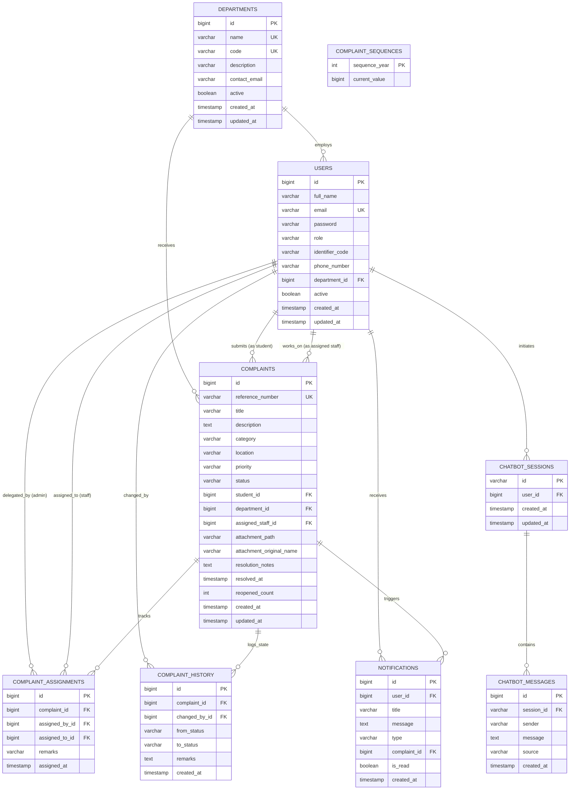

# CampusCare: Database Design & Entity Relationship Diagram (ERD)

## 1. Entity Relationship (ER) Diagram



---

## 2. Concurrency-Resistant Reference Generation Mechanism
Rather than computing `COUNT(*)` (which causes severe race conditions and duplicate primary keys under concurrent user requests), CampusCare implements an atomic sequence table `complaint_sequences`:
```sql
CREATE TABLE complaint_sequences (
    sequence_year INT PRIMARY KEY,
    current_value BIGINT NOT NULL
);
```
At runtime, `ReferenceNumberGenerator` executes inside an isolated transaction (`@Transactional(propagation = Propagation.REQUIRES_NEW)`) and locks the row for update:
```java
@Lock(LockModeType.PESSIMISTIC_WRITE)
@Query("SELECT s FROM ComplaintSequence s WHERE s.sequenceYear = :year")
Optional<ComplaintSequence> findBySequenceYearForUpdate(@Param("year") Integer year);
```
This guarantees strictly unique, monotonic identifiers formatted as `CC-2026-000001`, `CC-2026-000002`, etc., without concurrency collisions.
