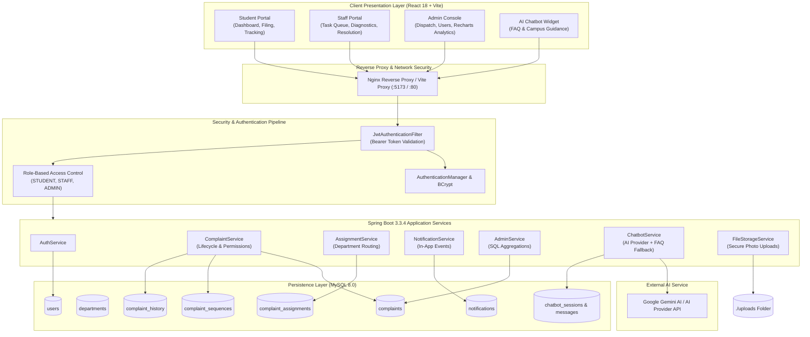

# CampusCare: System Architecture Specification

## 1. Executive Summary & Architecture Overview
**CampusCare** is an enterprise-grade, full-stack, AI-enabled College Complaint Management and Resolution System engineered for academic institutions. The system utilizes a modern three-tier decoupled architecture:
1. **Presentation Layer**: Single Page Application (SPA) built with React 18, Vite, Bootstrap 5, and Recharts.
2. **Application & Business Logic Layer**: RESTful Spring Boot 3 microservices with Spring Security, JWT stateless session authentication, Jakarta Bean Validation, and multi-provider AI integration.
3. **Data Persistence Layer**: MySQL 8.0 relational database with JPA/Hibernate ORM, atomic sequences, and audit histories.

---

## 2. High-Level System Architecture Diagram

---

## 3. Security Architecture
- **Stateless Authentication**: Every protected request presents an `Authorization: Bearer <JWT>` header verified with HMAC-SHA256 signature against server-side secret key.
- **Resource Ownership Validation**:
  - Students can query and view only their own complaints (`complaint.student.id == principal.id`).
  - Staff members can only view complaints assigned to them or matching their departmental scope.
  - Public registration strictly enforces role `STUDENT`. Staff and Admin accounts can only be created by an authenticated administrator.
- **Controlled Status State Machine**:
  - `SUBMITTED` -> `ASSIGNED` (by Admin)
  - `ASSIGNED` -> `IN_PROGRESS` (by assigned Staff)
  - `IN_PROGRESS` -> `RESOLVED` (by assigned Staff, requires resolution report)
  - `RESOLVED` -> `REOPENED` (by submitting Student)
  - `RESOLVED` / `REOPENED` -> `CLOSED`
